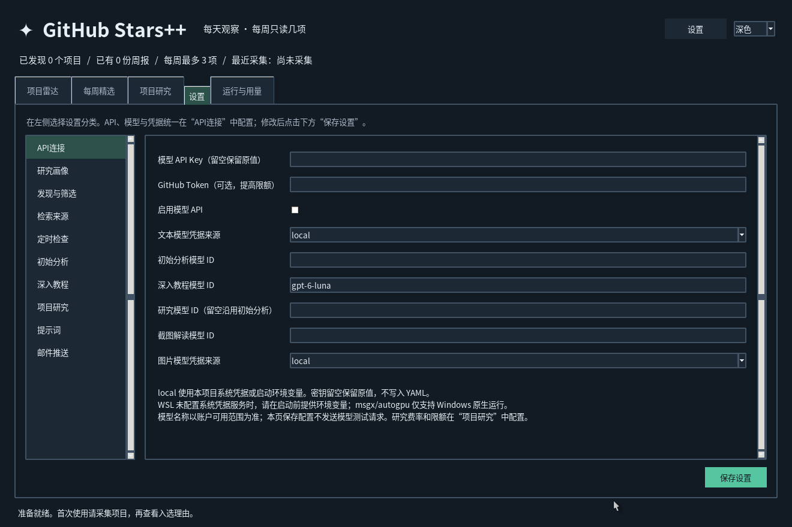

# GitHub Stars++ 0.2.1 使用说明

本工具帮助个人研究者发现、收集和学习GitHub项目，并围绕已保存的项目资料提问。桌面程序负责资料、检索、任务与记录；模型理解和生成通过配置的云端API完成。

## 1. 安装、升级与启动

使用Python 3.11独立Conda环境。已有安装升级时，保留`config.local.yaml`、整个`data/`和系统凭据，不用默认配置覆盖个人配置。

首次安装示例，在源码根目录执行：

```powershell
conda create -n github-stars python=3.11 pip -y
conda run -n github-stars --no-capture-output python -s -m pip install --no-user -e .
conda run -n github-stars --no-capture-output python -s -m github_stars --check-environment
conda run -n github-stars --no-capture-output python -s -m github_stars
```

只在环境不存在时创建。源码默认分支尚未包含此版本时，先切换到提供0.2.1的开发分支；本轮为`zhouhuijun/research-assistant`。源码启动器EXE依赖源码和环境，不能独立分发。

已有环境更新源码后，重新执行editable安装即可刷新包版本；只有依赖变化时才需要更新依赖。数据库沿用0.2.0的schema 3，关闭应用后备份配置和数据，不用旧版本打开已升级数据库。

## 2. 设置入口与分类

点击窗口右上角“设置”，或主导航中的“设置”。右上角按钮直接进入“API连接”；设置页左侧切换分类，右侧编辑，底部统一“保存设置”。没有新的连通性测试请求；已启用的自动任务仍可能按新设置运行。

下图使用临时空白配置，不包含真实密钥：



| 分类 | 配置内容 |
| --- | --- |
| API连接 | 模型API开关、Key、GitHub Token、文本/图片凭据来源及各用途模型ID |
| 研究画像 | 研究背景、研究关键词、热点关键词 |
| 发现与筛选 | Star门槛、周报数量、筛选分数、推荐冷却期 |
| 检索来源 | GitHub研究查询及热点查询 |
| 定时检查 | 自动检查开关、时区、采集和周报时间 |
| 初始分析 | 自动短分析、服务等级、次数、输出及README额度、超时 |
| 深入教程 | 教程服务等级、次数、输入输出限制及超时 |
| 项目研究 | 研究服务等级、调用/工具/图片/时间限制、估算费率与个人关注点 |
| 提示词 | 初始分析和教程的提示词 |
| 邮件推送 | SMTP设置、授权码及邮件开关 |

模型ID从原来的不同页面集中到“API连接”，底层设置字段保持原名。切换分类不会丢弃尚未保存的表单内容；保存会校验所有分类。任务运行中不允许保存，以免改变正在执行的配置。

## 3. 配置模型API

1. 进入“设置 → API连接”。
2. 文本凭据来源选择`local`，或在Windows原生运行时明确选择已有的`msgx`/`autogpu`来源。
3. 填写账户确实可用的初始分析模型ID；研究模型留空时复用它。
4. 按需填写教程模型及支持图像的截图解读模型；图片凭据来源单独选择。
5. 准备凭据后勾选“启用模型API”，点击“保存设置”。

本项目使用OpenAI Responses与结构化结果。模型ID以所用账户支持范围为准，界面不会主动付费试探模型能力。保存配置不证明认证成功，第一次真实操作的状态和实际用量要在“运行与用量”查看。

希望先手动尝试时，在“初始分析”关闭“打开项目时自动做首次短分析”，在“定时检查”关闭自动检查。已有个人开关不会因升级被重设。

### 3.1 Windows原生凭据

“模型API Key”和“GitHub Token”输入框保存到本项目的系统凭据条目，界面使用掩码，保存后清空输入框。留空表示保留原条目，不代表删除或没有凭据。SMTP授权码在“邮件推送”保存。

`local`读取时优先使用启动环境变量，其次读取本项目系统凭据。`msgx`和`autogpu`仅在请求时读取明确选择的已有Windows条目，不复制密钥，也不自动改用其他来源。

### 3.2 WSL没有凭据服务时

WSL不保证有可用的系统凭据服务。没有服务时，GUI无法永久保存Key，会明确报错；公开GitHub可以匿名读取，其他密钥可以通过启动环境提供。不要把密钥放到YAML、启动脚本或Git中。

先关闭已有应用，在同一个WSL终端执行：

```bash
read -r -s -p '输入模型 API Key：' OPENAI_API_KEY
printf '\n'
export OPENAI_API_KEY
bash tools/start_wsl.sh
unset OPENAI_API_KEY
```

输入值不显示，也不会成为命令历史中的字面密钥。已启动子进程持有自己的环境，终端随后unset不撤回该进程的值。这个Key只供本次进程使用；直接双击快捷方式不会继承另一个终端临时设置的变量。

GitHub Token同样可以在启动前通过`GITHUB_TOKEN`提供；SMTP使用`GITHUB_STARS_SMTP_PASSWORD`。WSL不支持`msgx`/`autogpu`的Windows凭据复用入口。长期保存应配置系统凭据服务，或使用Windows原生运行方式。

## 4. 先收集项目

在“项目雷达”点击“粘贴仓库链接”，例如输入本项目：

```text
https://github.com/zhaotingding/GitHub-Stars
```

一次最多10个不同仓库；普通URL、Markdown链接和`tree`/`blob`子页面会归一到所属仓库。手动导入不受最低Star或画像门槛限制，但GitHub访问权限和限流仍适用。

“立即采集”使用“检索来源”里的查询进行有限采样。研究画像影响筛选和解释，查询决定发现范围；只改背景介绍不会自动改变GitHub查询。按自己的方向调整查询和关键词。

如果状态提示HTTP 403/429，先查看是否限流，等待额度恢复或配置GitHub Token。本机一次匿名导入曾返回403，导入0个项目；命令退出码0不能代替业务成功状态。首次Star观测没有增量基线，热度不等于效果。

## 5. 整理项目与生成教程

在列表选择待研究、收藏、重点、正在研究、已研究；这些是本地研究状态，与GitHub账号点Star分开。

- “初始分析”：快速解释项目用途和学习价值，已有成功结果复用。
- “生成HTML教程”：主动新建一次教程任务，内容含概念、流程、实践步骤和检查点。
- “打开已有教程”：打开本地结果，不重新生成。
- “任务与恢复”：查看原有分析/教程的状态与原结果恢复入口。

教程来源于所提供资料，软件没有安装被研究仓库、运行其中命令或验证实验效果。打开HTML可以离线学习；复制代码不会自动执行。

## 6. 标准问答

先完成项目导入和模型配置，再进入“项目研究”：

1. 选择“标准问答”。
2. 范围选择全部本地缓存，或雷达中当前选中的项目。
3. 输入具体问题，点击“开始研究”。

示例：

> 已保存的项目中，哪些适合从传统视觉转向机器人多模态感知？请列出输入、输出、学习价值和资料缺项。

程序先检索本地资料，再让模型依据证据回答。没有命中且没有图片附件时不调用模型。检索使用相关表达、关键词和字符片段，没有引入向量数据库。

回答中的`R…`是当前项目资料，`H…`是保存的历史README，`I…`是图片描述。点击引用查看来源节选、链接、版本标识和采集时间。程序校验引用身份，结论是否充分符合原文还需核对。

## 7. 受限Agent与图片

选择“受限Agent”后，模型可以按需补查本题冻结的本地资料、读长节选、看历史和偏好、理解允许的图片，或结束回答。执行记录展示实际工具动作。

示例：

> 比较这些项目的输入输出和部署条件。资料不够就补查，缺少显存、帧率数据时明确说明。

它不能自行扩展到未导入项目，也不能执行Shell、仓库代码、任意文件读取、Git推送或邮件发送。

读图需要选择本地PNG，并勾选“仅本题允许读图”。示例：

> 解释这张架构图中可见的模块和数据流，结合README，区分图中直接显示的内容与推测。

图片当前最多2MB、单边4096和1200万像素，只接受有效静态非隔行8位灰度/RGB/RGBA PNG。标准模式最多一张；Agent受配置限制最多两张。不会自动下载README图片。成功描述可按内容缓存复用，缓存不证明解释已验证。

## 8. 费用、恢复与记录

在“设置 → 项目研究”填写所用模型及服务等级的人民币/百万Token估算费率，文本与图片分别填写。默认0表示未知，会阻止新收费步骤。

默认每题最多3次模型调用、4次工具动作、1张图片、180秒和0.5元本地估算额度；每周研究调用默认20次。决策、图片分析和最终回答都占模型调用，默认值适合有限补查。金额估算不是供应商账单硬封顶。

| 操作 | 行为 |
| --- | --- |
| 刷新状态 | 读取本地记录，不新建模型请求 |
| 取回原结果 | 读取已存响应，或按已有ID取回，不重新POST |
| 明确继续 | 在原任务剩余限制内允许后续新调用 |
| 停止后续步骤 | 阻止后续步骤，不能撤销已经提交的费用 |
| 收藏回答 | 保留问题、答案和轻量来源指针 |
| 有用/不相关 | 有限调整后续检索排序，不训练模型 |

继续和恢复不重置时间、次数或费用。未知且无响应ID的提交不自动重发。普通任务材料保留七天；收藏保留轻量结论与来源位置，用量账目独立保留。

## 9. WSL启动与中文显示

WSLg需要可用图形桌面。激活已安装本项目的专用Conda环境后：

```bash
bash tools/start_wsl.sh
```

也可以明确指定解释器：

```bash
GITHUB_STARS_PYTHON=/你的独立环境/bin/python bash tools/start_wsl.sh
```

启动脚本也会识别源码相邻的`.task_envs/github-stars`。启动器拒绝base和不完整环境，保留单实例锁，日志在`data/desktop.log`；源码与环境不能移动后直接沿用旧快捷方式。

某些Conda Tk没有Xft，中文会显示为`\uXXXX`。WSL启动器检查这种构建，在本机存在时为GUI进程选择`/usr/lib/x86_64-linux-gnu/libtk8.6.so`及`/usr/share/tcltk/tk8.6`，不修改系统文件或base。系统需要可用的中文字体，例如Noto Sans CJK SC；界面按实际字体选择，Windows优先微软雅黑。

本机现有桌面快捷方式通过WSL启动，不是独立Windows安装包。修复验收包含实际截图和中文字形检查；直接绕过启动器运行不含这些WSL渲染设置。

## 10. 数据、周报与排障

| 内容 | 位置 |
| --- | --- |
| 个人设置 | `config.local.yaml` |
| 项目、研究状态、任务及用量 | `data/stars.sqlite3` |
| 教程 | `data/tutorials/` |
| 周报 | `data/reports/` |
| WSL窗口启动日志 | `data/desktop.log` |

周报默认最多三个项目，生成需要近期完整采集；不足门槛可以少推。邮件需要单独启用SMTP。Windows后台计划任务需要当前用户登录且电脑开机；WSL启动器只启动桌面，不安装自启。

常见问题：

- **没有项目**：先导入或采集，查看业务状态，尤其是GitHub限流提示。
- **设置保存失败**：检查模型ID、字段范围、费率和凭据服务；任务运行中先等待完成。
- **点击研究未发请求**：检查总API开关、模型、凭据、费率、资料命中和剩余限额。
- **Agent达到限制**：查看已执行步骤，缩小问题或在下一题合理配置限额。
- **Key在终端设置了却没生效**：先关闭旧窗口，再从同一终端启动；单实例保护不会替换旧进程环境。
- **中文为转义串**：通过`tools/start_wsl.sh`启动，检查系统Tk和中文字体，查看日志。
- **更新后仍是旧界面**：关闭旧进程，核对分支和版本，刷新editable安装，再用原启动方式打开。

本轮自动化验证及真实使用边界见[0.2.1验收记录](verification-0.2.1.md)；完整安装、计划任务和数据备份规则见[主README](../README.md)。
