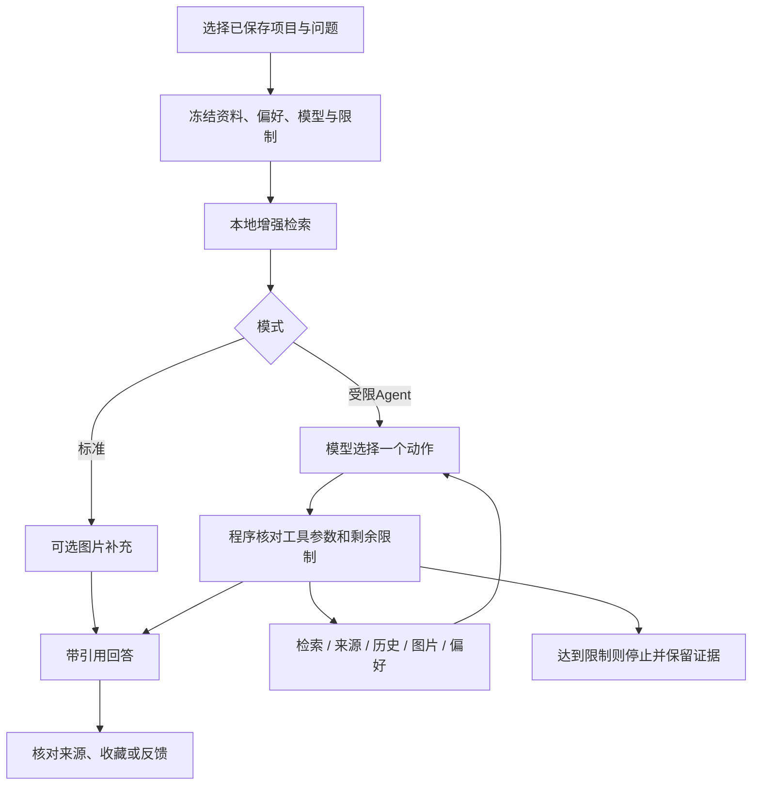

# GitHub Stars++ 0.2.0：四阶段智能化升级说明

日期：2026-11-06。目标仓库为 `zhaotingding/GitHub-Stars`，Python包为 `github_stars`。本轮从该仓库最新0.1.1代码重新实现，在它的项目资料和研究流程上增加四阶段能力。

## 1. 改了哪些内容

| 阶段 | 新增能力 | 实际用途 |
| --- | --- | --- |
| 第一阶段：有来源的项目问答 | 新“项目研究”页；标准问答；固定项目范围；逐条结论引用；来源节选、链接、SHA和采集时间 | 问“哪些项目能用于机器人感知”，然后点击引用核对README |
| 第二阶段：增强检索和跨天整理 | 相关表达、字符片段相似度、补查与长节选；保存README版本；Star时间线；主题和重复节选整理 | 补查不同说法，比较保存过的版本与跨天观测 |
| 第三阶段：图片和个人研究偏好 | 每题明确允许PNG附件；独立图片模型/凭据来源/费率；成功描述缓存；关注点与少关注词；收藏和反馈 | 理解截图，并把有用结论留在自己的研究记录中 |
| 第四阶段：受限研究工具循环 | 模型动态选择检索、来源、历史、图片或偏好工具；逐步持久化；取回、继续、停止；次数、金额估算和时间限制 | 资料不足时有边界地补查，资料充分时给带引用回答 |

这轮保留原有的采集、手动导入、研究状态、初始分析、主动HTML教程、周报和邮件机制。研究任务使用自己的表和次数限制，不挤占初始分析或教程的请求身份。

## 2. 两种模式如何选择

**标准问答**：先检索当前已保存资料，再根据这些证据回答。没有命中且没有图片附件时直接说明，不调用模型。明确添加并允许读图时，可先理解一张截图再回答，至少需要两次剩余调用。

**受限Agent**：初次检索后，模型决定补查关键词、读取更长来源、查版本/Star历史、理解附件、查看偏好，或者直接回答。初次检索为空也可能调用模型生成补查词，不代表零费用。所有工具都受固定资料范围与限额约束。



## 3. 开始前的配置

在“偏好与连接”里设置并启用模型API。新“项目研究”设置包含研究模型、图片模型和各项限制。

| 设置 | 默认值或含义 |
| --- | --- |
| 研究模型 | 留空时复用初始分析模型ID；凭据来源沿用初始分析选择 |
| 图片模型 | 默认留空；新读图前必须填写账户可用、支持图像的模型ID |
| 图片凭据来源 | 单独选择local、msgx或autogpu，仍沿用项目已有凭据读取机制 |
| 服务等级 | default；可选flex，不自动切换更贵等级 |
| 每题模型调用上限 | 3次，可设置1～6次；决策、回答和新图片分析合计 |
| 每题工具上限 | 4次，可设置0～8次 |
| 每题图片上限 | 1张，可设置0～2张；标准模式最多补一张，Agent可按限制选择 |
| 每周研究调用上限 | 20次，可设置1～100次；失败/未知也占次数 |
| 单步输出上限 | 4000 Token，可设置1000～8000 |
| 单步文本输入字符上限 | 24000，可设置4000～50000 |
| 每题绝对时限 | 180秒，可设置15～900秒 |
| 历史观测窗口 | 30天，可设置1～90天；当前本地项目资料不因较早导入而自动消失 |
| 每题估算金额上限 | 0.5元，可设置0.01～100元 |
| 文本输入/输出费率 | 默认0.0，表示未知；填写所选模型、档位对应的人民币/百万Token估算费率 |
| 图片输入/输出费率 | 单独填写图片模型费率；新分析图片前必须大于0 |
| 关注点/少关注词 | 各最多12项，每项2～50字；允许留空 |

费率不自动猜测。真实费率、币种换算和服务档位由你根据所用账户确认；填0表示未知，新收费步骤会停止并提示。没有新增API Key写入YAML的做法，密钥仍交给原有系统凭据或明确选定的既有来源。

研究和截图都使用官方OpenAI Responses，沿用已有SDK并关闭SDK自动重试。图片输入和结构化输出的接口依据见 [OpenAI图像输入说明](https://developers.openai.com/api/docs/guides/images-vision) 和 [结构化输出说明](https://developers.openai.com/api/docs/guides/structured-outputs)。模型是否支持具体能力以账户和服务端为准；不会为试探能力主动发起额外付费请求。

如果只想使用项目研究，可关闭“打开项目时自动做首次短分析”；初始分析的自动行为仍由原有设置控制。研究功能不会触发长教程或邮件。

## 4. 操作实例一：寻找适合自己的项目

先通过“粘贴仓库链接”或正常采集，把目标项目和README保存到雷达中。然后打开“项目研究”，选择全部本地项目，使用标准模式，输入：

> 已保存的项目中，哪些适合从传统视觉转向机器人多模态感知？请说明项目解决的问题、学习价值和缺失信息。

点击提问。回答中会出现`[R数字]`等引用。点击引用可查看采集时的README节选、来源链接、版本SHA和采集时间，再判断结论是否被原文支持。

程序检查引用编号属于本次输入，但不能自动证明文字结论正确。作者宣称的效果、模型解释和真实实验应分开看；这里没有安装或运行被推荐的项目。

如果只想研究一个项目，在雷达选中它，再在研究页选择当前项目范围。忽略状态的项目不进入研究资料；不存在的项目编号会拒绝，模型不能扩展到其他项目。

## 5. 操作实例二：让Agent补查和比较

模式选择“受限Agent”，输入：

> 比较这些视觉语言项目的输入输出、机器人适用场景和部署条件。先找依据，资料不够就说明，不要猜测显存或帧率。

可能的过程：初始检索找到有关视觉语言的资料；模型补查“robotics”“inference”等表达；读取一条已观察来源的更长节选；最后回答。它也可以第一轮直接回答。

在执行记录中查看实际动作与结果摘要。每次模型选择动作也占一次调用，默认三次仅适合有限补查；达到限额会保留已找到的证据并停止，不会无限循环。

当前工具清单：

| 工具 | 范围 |
| --- | --- |
| search | 在创建任务时冻结的本地资料中补查词语 |
| read_source | 读取已经看到的来源的更长节选 |
| history | 读取该项目已保存的README版本与Star观测 |
| image | 只理解用户本题明确添加且允许的PNG附件 |
| preferences | 查看任务创建时冻结的画像、关注点与少关注词 |
| answer | 结束研究并给出逐条带引用的结论 |

工具不能执行SQL、Shell、仓库代码、任意文件读取、互联网搜索、Git提交或邮件投递。要研究新项目，先在原有导入入口保存该项目，再创建新问题。

## 6. 操作实例三：看历史和跨天变化

输入：

> 这些项目最近保存的README有哪些版本变化？Star增长是否有足够的跨日观测支持？

查看组织页的主题、README历史来源、重复节选和Star时间线。保存新README前会归档原版本，新版本也留有采集记录；升级时会归档已有缓存。升级前未保存过的更早版本无法补造。

`R`表示当前缓存的项目资料，`H`表示已保存的README历史版本。SHA标识来源版本，采集时间只是程序何时读到它，并不等同于作者提交时间。相邻观测的Star差值也不代表每天持续增长，首次观测无增量基线，Star多不证明项目质量。

相同节选会归组，保留各自来源；带不同数值的实验文本不按同一份重复证据处理。字符相似度和相关表达用于检索，它们不是向量语义模型，也不是效果基准测试。

## 7. 操作实例四：理解截图

用系统截图工具保存一张本地PNG，例如你自己保存的架构图或实验曲线。新问题中添加附件，明确勾选本题允许读图，输入：

> 请解释这张架构图中可见的模块和数据流，并结合已保存的项目README说明。区分图片直接显示的信息与推测。

标准模式会先补充一张截图描述再回答；Agent从本题附件中按限制选择。截图不自动从README网址下载，也不根据模型给出的文件路径读取。附件许可默认关闭，需要每题明确选择。

当前只支持有效的静态、非隔行8位灰度/RGB/RGBA PNG，最多2MB、边长4096和1200万像素；拒绝动画、损坏结构、异常解压、越界大小和符号链接文件。需要其他格式时先自行转成PNG。

成功描述按内容指纹复用，不重新上传；未知或仍待解决的同图请求阻止跨问题重复上传。已有步骤的结果恢复不重新读取附件文件，也不重新发送图片。缓存只说明此前成功得到描述，不代表图中结论已验证。

## 8. 操作实例五：关注点、收藏和反馈

在“项目研究”设置里填写：

```text
关注点：
机器人视觉
多模态
部署推理

少关注词：
课程推广
投资营销
```

这些词只有限调整相关资料的排序，不把无关项目强行变成证据，也不改变原始周报排名。设置在每题开始时冻结，之后修改不影响在途任务。

回答完成后可以收藏、取消收藏、标记有用/不相关或清除反馈。反馈给本题检索词留下有限排序信号，不训练模型，也不是事实验证。研究收藏和雷达的“项目收藏”是不同记录：前者保存答案与来源位置，后者管理项目研究状态。

普通任务和输入快照保留七天，收藏长期保留问题、答案和轻量来源指针，不复制完整README、原图或API材料。到期后可以查看收藏，但需要根据来源链接重新核对原文；用量账本独立保留，未知用量不当作零费用。

## 9. 超时、停止和恢复如何选择

| 操作 | 含义 |
| --- | --- |
| 查看/刷新状态 | 只读本地结果，不创建模型请求 |
| 取回原结果 | 使用已保存原响应，或按已接受的响应ID执行GET；不重新POST |
| 继续研究 | 明确允许剩余步骤产生新调用，仍使用原范围、模型、偏好和剩余限制 |
| 停止任务 | 停止后续步骤；已提交请求仍可能产生费用，允许取回原结果核对 |
| 新建问题 | 新的任务身份和限制，可能产生新费用 |

任务截止时间、已预留金额和调用次数不会因继续、停止、重开或取回而清零。未知且没有响应ID的提交不重新发送；格式或引用错误也不自动追加修复请求。

新请求先按有界文本、最大输出和图片输入预留估算费用；若实际返回用量对应的估算费用更高，用更高值检查后续额度。用量缺失时停止新增收费步骤。费率和Token预留都是本地估算，不能替代供应商账单硬封顶。实际模型、档位、Token和费用估算在“运行与用量”中单独列出。

## 10. CLI实例

执行位置为本项目根目录，使用已有专用Conda环境。设置与界面共用，不向终端参数传API密钥。

```powershell
conda run -n github-stars --no-capture-output python -s -m github_stars research --question '哪些已保存项目适合机器人感知？' --mode standard
conda run -n github-stars --no-capture-output python -s -m github_stars research --question '比较这些项目的部署条件' --mode agent --repo-id 123
```

返回结果中的`research_job.id`是本题编号，把下面的`任务编号`替换为该值：

```powershell
conda run -n github-stars --no-capture-output python -s -m github_stars research-status --job-id 任务编号
conda run -n github-stars --no-capture-output python -s -m github_stars research-resume --job-id 任务编号
conda run -n github-stars --no-capture-output python -s -m github_stars research-continue --job-id 任务编号
conda run -n github-stars --no-capture-output python -s -m github_stars research-cancel --job-id 任务编号
conda run -n github-stars --no-capture-output python -s -m github_stars research-bookmark --job-id 任务编号
conda run -n github-stars --no-capture-output python -s -m github_stars research-feedback --job-id 任务编号 --rating useful
```

取消收藏使用`research-bookmark --unsave`，清除反馈使用`--rating clear`。图片示例需要本题许可与有效PNG：

```powershell
conda run -n github-stars --no-capture-output python -s -m github_stars research --question '解释架构图' --allow-images --image 'D:\Images\architecture.png'
```

## 11. 代码和数据变化

| 模块 | 职责 |
| --- | --- |
| research.py | 模型动作、引用检查、限额、逐步调用与恢复 |
| research_search.py | 有界资料快照、相关表达/字符检索、时间线与PNG准备 |
| research_store.py | 研究任务、逐步原响应与用量、版本、缓存、反馈和轻量收藏 |
| research_ui.py | 项目研究页、来源导航、记录与按钮状态 |
| service.py / gui.py / __main__.py | 共用服务入口、GUI接线和CLI控制 |
| defaults.yaml / config.py | 新研究设置、严格校验与旧设置补默认值 |

数据库schema升级到3，保留原项目、选集、任务、原响应、用量和邮件记录，增加独立研究表与README版本。升级后不要用0.1.1打开该数据库。备份和升级仍遵循主README的资料保留说明。

资料快照最多100个本地项目、100份历史版本，README单份最多16000字符，总正文240000字符；Star观测最多600条。初始检索最多12条来源，工具累计最多24条，长节选最多8000字符，实际发送还受单步输入额度约束。超过限额的资料明确标记截断，不代表全部项目或完整历史。

没有引入新的运行依赖、向量数据库、额外本地模型或Agent框架。开发验证使用新项目专用Conda环境；测试数据、模型与SMTP均为隔离替身，不把模拟输出当成真实模型质量或邮件到达证明。完整157项回归与未实测范围见 [0.2.0验收记录](verification-0.2.0.md)。
