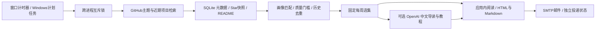

# 0.1.0 设计与边界

## 目标

用户没有时间每日读榜单。程序每天积累项目证据，每周最多推荐几个有研究价值的项目，提供短摘要与可继续深入的教程。首版选择 Windows 原生 Tk 桌面＋Python＋SQLite，避免为了个人阅读引入独立服务器和前端构建链。

## 来自 MsgX 与 AutoGPU 的经验

参考它们当前项目技能与启动实现，吸收流程约定，没有复制个人配置、业务数据或凭据。

- 程序、Conda 环境、个人设置、持久数据分别管理。启动器仅选择环境并调用源码，后台与界面共用业务服务。
- 设置缺失应显示待配置；不能把窗口打开当成 API／邮件连接成功。
- 生成、成稿、使用量、投递分别持久化。已返回结果先保存，再解析；已有响应优先恢复，未知提交不自动重发。
- 原始内容与系统指令分离；纯营销和资料合集不因为星多就自动进入推荐。
- API／邮件验证使用模拟数据；真实账号、真实收费与真实投递单独记录。

## 工作链

`service.py` 是唯一工作协调层。CLI、GUI 和计划任务都调用 `Service.run`；SQLite 每个操作创建独立连接，批量原子步骤使用同一事务。操作系统文件锁随进程退出释放，避免过期 PID 锁导致永久卡死。

## 筛选

检索分研究、高星热点、近期新项目三路；每条只取有限样本。评分基于仓库名、简介、topics 的关键词匹配，加入饱和处理后的 Star、近期提交、许可证、README、跨日 Star 净变化。只做可解释启发式，不声称理解完整代码质量。收藏在达标后优先，不能越过阈值；忽略直接排除。

每周默认两个研究名额、至多一个热点名额；不足可少推。单作者每期至多一项。周报冻结当时入选元数据与理由，90 天冷却避免重复。因采集不完整而阻止生成新周报，避免把故障误判成“本周没有好项目”。无达标项目时应用内记录，自动邮件静默。

## 教程与恢复

每次 POST 前保存任务、原始证据、模型和周期。禁用 SDK 自动重试。返回后先保存响应 ID、原始响应和服务端 Token，再验证结构化教程。材料有长度上限及截断标记。成稿有快照 SHA、采集时间与来源。

未知提交无 ID 时需人工核对；已保存结果可本地解析，已知 ID 可 GET 原响应。GET 不新建任务、不切换模型重新生成。明确重试才发新 POST，仍计入周调用上限。周期用画像设置的时区和 ISO 自然周；首版不估算金额。

## 邮件

周报保存与发送分开。`pending → sending → sent`；连接阶段失败是 `failed`，发送阶段中断是 `unknown`。重启遇到 `sending` 转为未知，避免重复邮件。稳定 Message-ID 只是辅助识别，不承诺服务商一定去重。空选集不自动发信。

## 首版明确未覆盖

- 不是 24 小时云服务；本机睡眠／关机／退出登录无法运行。
- 不读取 GitHub Trending HTML，不监测所有仓库、不抓新闻、不用未测的“趋势”冒充真实热度。
- 不执行下载项目，不自动安装其依赖，不运行教程命令，不验证论文效果。
- 不提供第三方 OpenAI 兼容服务、聊天机器人渠道、多人协作或移动端。
- 没有机器学习式偏好反馈，只支持画像编辑、收藏和忽略。
- 收件人与 API 未配置时，仅提供本地功能；真实收费和投递需独立验收。

## 后续可迭代方向

0.1.x 优先根据实际周报纠正噪声、补充兴趣词与检索语句，完善来源覆盖和教程质量。积累真实使用数据后再考虑主题聚类、重大版本更新再推荐、阅读反馈、金额预算，以及独立常驻服务。尚未实现的方向不放进首版能力清单。
