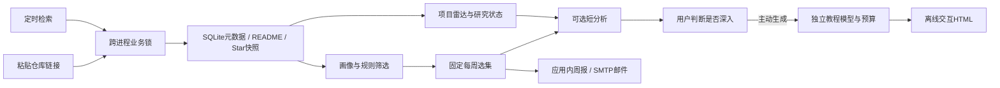

# 0.1.1 设计与边界

## 学习路径

GitHub Stars++ 面向没有时间逐日读榜单的个人研究者。每天发现项目，手动补充阅读中遇到的仓库；先用短分析回答“有什么用、与我有什么关系”，再由用户判断是否投入，主动生成能走到实践、改进和 PR 的深入教程。

Windows Tk 桌面、Python 和 SQLite 沿用 0.1.0。源码、专用 Conda 环境、个人 YAML、系统凭据和数据分别管理；启动器、GUI、CLI、计划任务共用业务服务。窗口出现、凭据可读、API 返回和真实投递分别判断。

## 主题、导入与研究状态

`appearance.theme` 默认 `dark`，保存在个人 YAML。主题服务统一设置 Tk／ttk 及应用自有提示、导入、状态和恢复窗口；不依赖原生系统消息框配色。HTML 使用当前主题导出，浏览器页内可独立切换。

自动发现仍分研究、高星热点和近期项目三路，每条是有限样本。手动导入从普通 URL／Markdown 中提取 GitHub 链接，子路径归一、按仓库去重，每次最多 10 项，通过 GET 直接读取，不先匹配 Star 或画像。进入个人雷达和进入周报是不同门槛。

`repos.study_state` 保存 `pending/saved/studied/focus/studying`，组织个人研究进度。旧 `feedback` 保留兼容：旧收藏映射为收藏，旧忽略继续排除，设置新状态后可恢复。状态变化不重写历史选集。

## 筛选与少量阅读

评分基于仓库名、简介、topics 关键词，以及饱和处理后的 Star、近期提交、许可证、README 和跨日净变化。无跨日基线就保留增速未知；规则分数不是代码质量或论文效果评价。

每周最多 3 项，其中热点最多 1 项，单作者至多一项，90 天内已推荐项目排除；不足可少推。按配置时区 ISO 自然周冻结元数据和理由。最近采集不完整时不封存新周报，空选集只在应用记录，不自动发信。

## 分离的生成任务

`ai_jobs.kind` 区分 `analysis`、`tutorial`、`legacy`。缓存、恢复、用量上限和展示按用途查询，避免短分析与教程混用。schema 1→2 增加研究状态、手动来源、任务类型、请求设置／提示词与实际模型／等级，保留旧快照、原响应、用量和选集。

短分析使用 `ai` 设置，新配置每周 10 次、输出 4000 Token、README 20000 字符。启用总 API 后，`auto_analyze` 可在首次打开项目和周报入选时生成一次短分析，关闭后由用户主动触发。

教程使用独立 `tutorial` 设置，默认 `gpt-6-luna`、Flex、输出 18000 Token、README 60000 字符、超时 900 秒、每周 3 次。每次主动点击生成新建任务，打开已有教程／恢复不重新 POST，定时任务不会生成教程。新默认值只补缺项，不覆盖个人已有预算。

两类提示词分别可编辑，开始任务时冻结。教程输入可附带已有短分析；相关项目只从 README 实际 GitHub 地址提取。固定规则区分来源、作者主张和待验证建议，不允许猜造安装命令、配置名或效果。

## API、恢复与凭据

POST 前保存用途、证据、模型、等级、预算和提示词，关闭 SDK 自动重试。返回后先存响应 ID、原响应、实际模型／等级与已知 Token，再校验成稿。截断、断线和未知提交不自动加预算、换模型或回退到更贵档位。

已保存结果优先本地恢复；有 ID 只 GET 原响应。无 ID 的未知提交先核对服务端记录，取回失败不是重新 POST 的理由。失败／未知也占用途周次数；次数不是金额预算，未知用量不当作零费用。

凭据可选本项目、MsgX、AutoGPU。既有条目仅在请求进程内读取，不复制、不新建旧应用凭据、不改变原配置。请求快照存来源引用，不保存密钥。Windows 用户、资料根或账户变化后，条目可读性与远端权限需核对。

## 结构化内容与离线教程

模型返回结构化 `Lesson`，固定模板生成 HTML，文字转义，不执行模型 HTML／JavaScript。可点击外链限制为有效 GitHub 来源。产物是 `data/tutorials/<repo_id>-<job_id>.html`，没有外部运行依赖。

交互服务于学习：逐节点解释流程，实践步骤与成功判据对应，代码复制、完成进度及重置、检查点展开。进度按教程文件隔离，勾选不代表程序实测。配置和相关项目解释选用条件；改进／PR 路线从可验证的小问题、测试和上游贡献说明开始。

## 邮件、调度与验证边界

周报和投递分别持久化。邮件 `pending → sending → sent`；发送前失败可延时重试，发送阶段中断保持 `unknown`。SMTP 接受不等于收件箱送达，明确重发仍可能重复。任务共用系统锁，每日去重，只补当前周期。

这是当前 Windows 用户的本机应用，睡眠、关机或退出登录时无法运行。它不执行收集仓库代码、不自动安装依赖，不验证教程命令、性能或论文效果；实验仍由用户完成。

SDK 模拟、迁移、Tk 与浏览器实际渲染分别验收。真实收费、教程质量、邮件投递独立记录，不以已有凭据、模型文档或模拟测试冒充真实生成。当前证据见 [0.1.1 验收记录](verification-0.1.1.md)，0.1.0 记录保留为历史。
