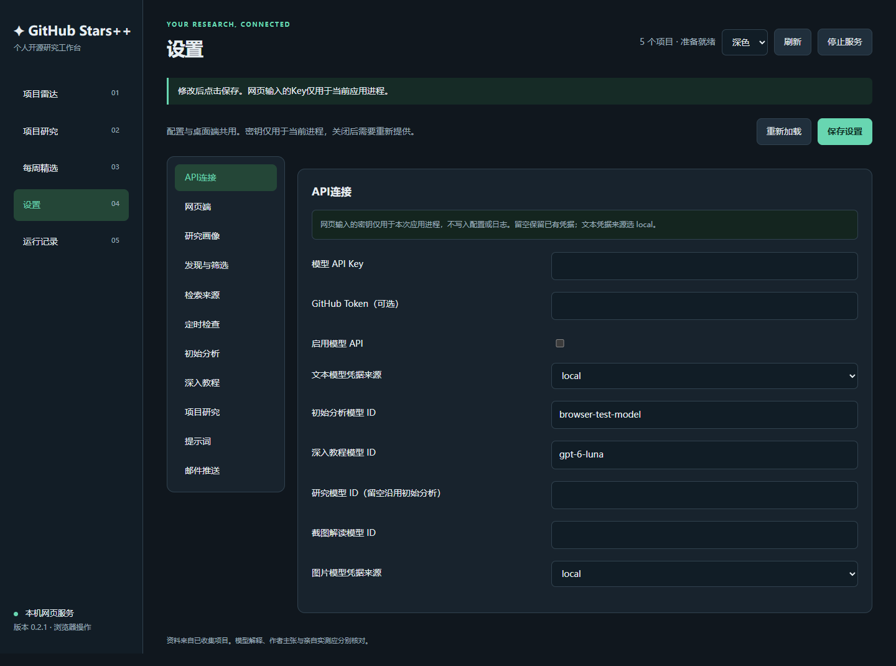

# GitHub Stars++ 网页端使用说明

网页端将项目雷达、研究问答、周报、设置及运行记录搬到浏览器中。它复用桌面端的`Service.run`、SQLite数据库、模型限制和恢复流程；可以独立运行，不需要先打开Tk窗口。版本随本轮0.2.1交付。

## 1. 启动与打开

已安装项目的独立Conda环境中执行：

```powershell
conda run -n github-stars --no-capture-output python -s -m github_stars web --open-browser
```

默认地址是`http://127.0.0.1:8765/`，终端会打印实际地址。保留这个终端运行；任务空闲时Ctrl+C可以关闭。

WSL可使用独立启动器，程序在后台运行并打开电脑的浏览器：

```bash
bash tools/start_web.sh
```

它与`tools/start_wsl.sh`的环境选择一致，可先激活专用Conda环境，或设置`GITHUB_STARS_PYTHON`；也识别源码相邻的`.task_envs/github-stars`。重复启动会打开同一资料目录已运行的网页，不重复创建服务。启动日志在`data/web.log`。

桌面程序右上角增加“网页端”，也可在“设置 → 网页端”点击“打开本机网页”。这种方式由桌面程序持有网页服务；网页任务进行时，桌面会提示等待或先停止研究。

端口占用时，关闭旧服务或明确指定其他端口：

```powershell
conda run -n github-stars --no-capture-output python -s -m github_stars web --port 8766 --open-browser
```

“设置 → 网页端”可修改默认端口，重启网页服务后生效。`--root`仍可指定其他资料目录，默认与桌面共用当前安装目录。

## 2. 页面对应关系

| 网页页面 | 操作 |
| --- | --- |
| 项目雷达 | 采集、链接导入、搜索、查看README和短分析、修改研究状态、生成教程、下载已有教程、恢复原生成结果 |
| 项目研究 | 标准问答、受限Agent、选择项目、PNG附件及逐题许可、引用原文、资料组织/Star观测、步骤记录、恢复/继续/停止、收藏与反馈 |
| 每周精选 | 生成及查看周报、HTML/Markdown导出、明确发送或重发邮件 |
| 设置 | 与桌面共用分类及配置；API、模型、研究费率、提示词、查询、定时和SMTP等 |
| 运行记录 | 本机操作状态、后台任务、错误、模型实际用量及研究估算费用 |

右上角可以刷新、切换深浅主题、停止网页服务。项目列表每次最多显示300条，搜索会查询全部已保存项目；可以先找到较早项目，再点击“围绕该项目提问”。

下面是使用临时测试资料截取的网页设置示例。模型名称为测试占位值，不是推荐模型；图片不含真实Key。



## 3. 配置API与Key

1. 左侧点击“设置”，默认进入“API连接”。
2. 文本凭据来源选择`local`，填写账户可用的初始分析模型ID。研究模型留空可以复用它；教程和图片模型可分别指定。
3. 在网页Key框输入密钥。网页输入的密钥只进入当前应用进程内存，保存后清空输入框，不写入YAML或日志，也不回传给页面。
4. 勾选模型API开关，点击“保存设置”。
5. 在“项目研究”中填写文本/图片估算费率及限制。默认费率0表示未知，会阻止新收费步骤。

Key留空会保留已有启动环境变量或系统凭据。Windows原有`msgx`/`autogpu`引用方式仍可选择；它们仅支持Windows原生运行，网页新输入的Key供`local`来源使用。

独立网页服务的Key仅供那个进程使用；桌面程序内打开的网页与桌面属于同一进程。关闭相应进程后，临时Key需要重新提供。浏览器关掉标签页不结束后台进程。

保存配置不会主动发送模型测试请求；已经启用的自动任务可能按新设置运行。希望先手动试用时，关闭“初始分析”的自动短分析和“定时检查”的自动检查。API真实可用性以实际任务和“运行记录”为准。

## 4. 收集、阅读和学习项目

在“项目雷达”粘贴GitHub仓库链接，点击“导入项目”。也可以点击“立即采集”，使用已保存的查询进行有限采样。

选择项目后，右侧显示简介、研究状态、README、已有分析和生成任务。点击“初始分析”会请求短分析；点击“生成教程”会主动创建新的教程任务。下载已有教程只读取完成结果，不创建生成请求。

已有教程作为HTML文件下载，打开后按概念、流程、实践和检查题学习。软件没有安装或执行被研究仓库，也没有验证性能。旧版legacy结果可以在项目详情的“旧版本记录”查看。

GitHub返回403/429时查看是否限流，等待恢复或在“API连接”提供GitHub Token。操作执行结束与业务成功分开判断，应看具体消息和项目数量。

## 5. 问答、Agent与图片

进入“项目研究”，选择标准问答或受限Agent，选择全部本地项目或具体项目，然后输入问题。

示例：

> 比较这些项目的输入输出、部署条件和机器人视觉适用场景。给出引用，资料缺失时明确说明。

点击引用可查看来源节选、版本和采集时间。“来源与执行记录”还展示资料组织、Star观测和工具动作。引用身份可追溯，具体结论仍需要核对。

图片通过浏览器文件选择器上传，每题必须勾选“仅本题允许读图”。只接受符合核心验证的静态PNG，单张最多2MB；标准问答最多一张，Agent在配置允许时最多两张。上传许可在提交后复位。程序不会根据网页传入的任意本机路径读取附件。

网页沿用每题/每周次数、时间、工具、图片和本地估算费用限制。Agent的决策和图片分析也占调用数。停止只阻止后续步骤，不能撤销已提交请求的费用。

## 6. 后台任务、恢复和重复操作

长任务在后台执行，页面定期读取状态；刷新页面不会重新POST生成请求。操作编号和状态保存在数据库，同一编号重试复用已有状态，参数不同会拒绝。

- 初始分析/教程：在项目的生成任务中点击“取回原结果”。
- 研究任务：历史中选择原问题，按状态使用“取回原结果”“明确继续”或“停止后续步骤”。
- 服务曾中断：网页操作显示结果未知，不自动重新执行；先检查原分析/教程/研究任务，再决定下一步。
- 关闭浏览器标签页：后台任务继续，重新打开同一服务可以看状态。

取回原结果沿用原响应；明确继续才允许剩余步骤的新调用，限额不会清零。研究任务材料与轻量收藏的保留方式沿用原规则。

## 7. 周报、邮件和自动检查

“每周精选”需要近期完整采集，可以生成、选择历史期次、查看文本及导出HTML/Markdown。

发送邮件前，需要在设置配置并启用SMTP；“发送周报”会要求确认。原投递状态为未知或失败时，先查收件箱，再决定是否“明确重发”。SMTP接受不等于进收件箱，重发可能产生重复。

独立网页服务会按现有“定时检查”设置每分钟检查是否到期，业务继续执行原来的去重、采集、可选短分析和邮件规则；不会自动生成长教程。由桌面打开网页时复用桌面计时器。电脑/WSL进程必须运行，休眠、关机或退出后无法按时检查，不安装新的系统自启任务。

## 8. 共用设置与关闭

桌面和网页共用配置文件。网页保存时校验配置版本；另一窗口已经修改时，会提示重新加载，避免旧表单覆盖新值。桌面也会检测这个冲突，可使用“重新加载已保存设置”。重新加载会替换当前未保存内容。

点击右上角“停止服务”可以停止本机网页；有任务运行时会提示先等完成或停止研究。再通过启动器或桌面入口打开即可重新启动。由桌面持有的服务也会随桌面正常关闭。

本版仅监听`127.0.0.1`，供同一台电脑浏览器访问；不提供公网部署、局域网多人登录或账户隔离。会话Cookie、同源/CSRF检查、Host限制及文本转义用于保护本机操作，不能当作公网服务的认证体系。

数据和备份规则仍见[主README](../README.md)及[0.2.1完整使用说明](0.2.1_使用说明.md)。
